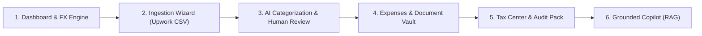

# Earnix — Final Year Project (FYP) Demonstration Walkthrough

**Project Title:** Earnix — AI-Powered Freelancer Income Management, Financial Recordkeeping & Tax Preparation Platform  
**Target Audience:** FYP Evaluation Committee, Academic Supervisors, External Examiners & Industry Jurors  
**Author / Developer:** Umar  
**Repository:** [https://github.com/umar778f/earnix-project.git](https://github.com/umar778f/earnix-project.git)  
**Live Platform:** [http://localhost:3000](http://localhost:3000)

---

## 1. Executive Summary & Problem Statement

Modern software engineers and digital knowledge workers in developing economies face distinct financial and compliance obstacles:
1. **Cross-Border Multi-Currency Fragmentation:** Income arrives via global platforms (Upwork, direct contracts) in foreign currencies (USD, EUR, GBP), while living and operational expenses occur in local fiat (PKR).
2. **Floating-Point Financial Loss:** Standard JavaScript arithmetic (`0.1 + 0.2 === 0.30000000000000004`) introduces rounding inaccuracies in financial ledgers that violate accounting standards.
3. **Opaque Platform Fees:** Platforms deduct 10%–20% service fees and withdrawal charges that freelancers often omit from gross income, leading to tax under-reporting or deduction losses.
4. **Tax Compliance Burden (e.g. FBR Section 154A):** Pakistan's tax regime provides a 1.00% final tax benchmark for IT/ITeS exports, but freelancers lack organized quarterly records, receipt substantiation proof, and accountant-ready export packs.
5. **AI Hallucination Risk:** Generic LLMs invent numbers when asked to perform financial arithmetic.

**Earnix** resolves these problems through an **arbitrary-precision dual-ledger architecture**, an **RFC 4180 Upwork ingestion engine**, a **human-in-the-loop AI categorizer**, a **deterministic RAG Copilot**, and a **statutory tax preparation center**.

---

## 2. 10-Minute FYP Evaluator Demonstration Script

Follow this sequential walkthrough during the live project defense:



---

### Step 1: System Vision, Metrics & Multi-Currency Engine (2 Minutes)
- **Route:** [`/dashboard`](http://localhost:3000/dashboard)
- **What to Demonstrate:**
  1. **Primary KPI Grid:** Point out the 8 core metrics: *Total Gross Income, Monthly Income, Annualized Trajectory, Total Expenses, Net Taxable Income, Estimated Tax Reserve, and Receipt Coverage*.
  2. **Real-Time Currency Switching:** In the top navigation bar, click the currency switcher dropdown and toggle between **USD ($)**, **PKR (₨)**, **EUR (€)**, and **GBP (£)**.
  3. **Explain to Jurors:** Notice that every metric, historical chart, and recent transaction immediately converts to the selected base display currency using historical exchange rates (Frankfurter API + State Bank of Pakistan benchmark fallback).
  4. **Highlight Core Principle:** *Original payment amounts and currencies are NEVER overwritten*. The database preserves the immutable dual-ledger: `original_amount`, `original_currency`, `exchange_rate`, and `converted_amount`. All math is computed with `decimal.js`.

---

### Step 2: Ingestion Wizard & Upwork Statement Reconciliation (2 Minutes)
- **Route:** [`/transactions/import`](http://localhost:3000/transactions/import)
- **What to Demonstrate:**
  1. Point out the **Ingestion Wizard** supporting official Upwork CSV export formats (`TransactionHistory_*.csv`) and Generic structured CSVs.
  2. **1-Click Evaluation Loader:** Click **"Load Sample Upwork Statement"** button. This instantly loads 9 realistic freelance transactions containing milestones, hourly salary contracts, Upwork service fee deductions, and wire withdrawals.
  3. Click **"Parse Statement"**:
     - Explain how the RFC 4180 parser handles commas inside quotes (e.g., `"$1,800.00"`).
     - Point out the automated classification:
       - 4 rows classified as **Gross Income** (Milestones & Hourly).
       - 4 rows classified as **Platform Service Fees** (10% Upwork fees).
       - 1 row classified as **Withdrawal** (Local wire transfer).
  4. Click **"Review & Reconcile"**:
     - Demonstrate automatic deduplication using unique constraint `uq_user_platform_ref(user_id, platform_id, reference_id)`.
     - Point out the toggle: *"Automatically record Upwork service fees ($475.25) as deductible business expenses"*.
  5. Click **"Commit to Ledger"** to ingest the records into the immutable transaction ledger.

---

### Step 3: AI Categorization with Mandatory User Review (2 Minutes)
- **Route:** [`/transactions`](http://localhost:3000/transactions)
- **What to Demonstrate:**
  1. Highlight the **AI Review Banner** at the top of the transaction ledger: *"3 transactions awaiting category review"*.
  2. Point out the **Sparkle Badge (`Pending Review`)** on each newly imported contract.
  3. Click **"Review AI Suggestions"**:
     - The modal reveals predictions powered by **Gemini 2.5 Flash** (with instant fallback to a weighted domain keyword taxonomy for offline resilience).
     - The AI analyzes contract titles (e.g., *"Next.js SaaS Architecture"* -> classified as *"Software Development"* with 92% confidence).
  4. **Key Academic Defense Point:** Emphasize that Earnix strictly follows the **Human-in-the-Loop AI Safety Principle**. AI suggestions NEVER commit silently. The freelancer must click **"Confirm Category"** or override it manually before it enters final tax accounting.

---

### Step 4: Expense Management & Document Vault (1.5 Minutes)
- **Route:** [`/expenses`](http://localhost:3000/expenses) and [`/documents`](http://localhost:3000/documents)
- **What to Demonstrate:**
  1. Show how Upwork platform fees were automatically routed into the business expenses ledger.
  2. Click **"Log Expense"**:
     - Record a business tool (e.g., *"GitHub Copilot & JetBrains IDE License"*, `$39.00 USD`).
     - Check *"Tax Deductible Expense"*.
     - Link an expense receipt from the **Document Vault**.
  3. Navigate to `/documents`:
     - Highlight the private Supabase Storage vault.
     - Files are organized with tenant isolation (`{user_id}/{document_id}.{ext}`).
     - Strict MIME validation (PDF, PNG, JPEG, CSV) and file name sanitization preventing path traversal attacks.

---

### Step 5: Statutory Tax Preparation Center & Audit Export (1.5 Minutes)
- **Route:** [`/tax`](http://localhost:3000/tax)
- **What to Demonstrate:**
  1. **Statutory Regime Benchmark:** Show Pakistan FBR Section 154A compliance module (1.00% benchmark for IT & ITeS export services).
  2. **Quarterly Ledger Breakdown:** Show the 4 fiscal quarters (Q1: Jul-Sep, Q2: Oct-Dec, Q3: Jan-Mar, Q4: Apr-Jun) broken down into Gross Income, Deductions, Net Taxable Income, and Estimated Tax Reserve.
  3. **Receipt Substantiation Score:** Point out the audit risk meter (e.g., *"85% of deductible expenses backed by verified receipts"*).
  4. **1-Click Accountant Package Export:**
     - Click **"Export Accountant Package (CSV)"**: Generates an RFC 4180 audit spreadsheet with full transaction references, exchange rates, and deductible expense breakdowns.
     - Click **"Print Summary"**: Opens a styled, ink-friendly printable tax computation report.

---

### Step 6: Earnix Copilot — Deterministic Grounded RAG Assistant (1 Minute)
- **Route:** [`/copilot`](http://localhost:3000/copilot)
- **What to Demonstrate:**
  1. Point out the grounded KPI strip at the top of the chat interface showing live ledger totals.
  2. Click suggested prompt: **"What was my highest earning month and client?"** or **"How much estimated tax do I owe?"**
  3. **Zero-Hallucination Architecture:**
     - Show the response: The AI cites exact figures computed by PostgreSQL and `decimal.js`.
     - Point out the **Clickable Database Citation Chips** (e.g. `[Acme Cloud Solutions - $1,800.00]`).
     - Clicking a citation navigates directly to the underlying ledger record, providing an unbroken audit trail.

---

## 3. FYP Defense Q&A Cheatsheet (Examiner Inquiries)

### Q1: "Why not use native JavaScript Numbers or standard SQL FLOAT?"
> **Answer:** Native JavaScript numbers use IEEE-754 double-precision binary floating-point representation. Operations like `0.1 + 0.2` result in `0.30000000000000004`, and `19.99 * 100` results in `1998.9999999999998`. In a financial ledger accumulating thousands of transactions and multi-currency conversions, cumulative rounding drift leads to severe financial and tax discrepancies. Earnix eliminates this by enforcing PostgreSQL `NUMERIC(14, 4)` at the database level and TypeScript `decimal.js` across all calculation pipelines.

### Q2: "How does Earnix prevent AI hallucinations in financial figures?"
> **Answer:** Earnix enforces a strict **Zero-Hallucination Architectural Separation**. The AI (Gemini 2.5 Flash) is NEVER the source of truth for arithmetic or calculations. All balances, quarterly tax estimates, and deduplication checks are executed by deterministic SQL queries and Decimal algorithms. Pre-computed, verified financial summaries are passed to the LLM solely for natural language explanation, contextual insights, and citation linking.

### Q3: "How is multi-tenancy and data isolation secured?"
> **Answer:** Earnix implements defense-in-depth across the entire stack:
> 1. **PostgreSQL Row Level Security (RLS):** All 9 application tables (`profiles`, `clients`, `transactions`, `expenses`, `documents`, `tax_profiles`, etc.) enforce `auth.uid() = user_id`.
> 2. **Supabase Storage Isolation:** The `documents` private bucket enforces folder-level RLS policies: `(storage.foldername(name))[1] = auth.uid()::text`. Users cannot access or delete other users' uploaded receipts.
> 3. **Input Sanitization:** Every Server Action parses incoming requests via strict Zod schemas, rejects path traversal sequences, and uses parameterized database queries.

### Q4: "What happens if the user is offline or the Gemini API is unreachable?"
> **Answer:** Earnix guarantees **100% Core Functionality Without External APIs**:
> - **Forex Fallback:** If public ECB/Frankfurter APIs are unreachable, the engine falls back to State Bank of Pakistan benchmark exchange rates.
> - **AI Categorization Fallback:** If the Gemini API is unconfigured or times out, Earnix activates a weighted heuristic classifier based on domain keywords and tax rules, ensuring zero downtime.
> - **Ingestion & Tax:** The CSV parser, dual-ledger engine, and tax calculator run entirely client/server-side without third-party dependencies.

---

## 4. Test Suite & Verification Results

Earnix includes an automated verification test suite covering 32 critical test cases:
```bash
npm run test:phase15
```

### Verified Test Categories:
1. **Financial Precision:** Verified `decimal.js` prevents floating-point inaccuracies.
2. **Dual-Ledger Invariants:** Verified USD/EUR/GBP/PKR exchange rate calculations and original amount preservation.
3. **Tax Engine & Date Boundaries:** Verified empty ledger resilience, leap-year calculations (Feb 29), and Section 154A benchmark tax rates.
4. **Statement Parsers:** Verified RFC 4180 Upwork parser and Generic CSV parser with quotes, commas, and negative fee rows.
5. **AI Categorization Fallback:** Verified domain keyword taxonomy classification without network access.
6. **Security & Input Sanitization:** Verified Zod schema rejection of negative amounts, invalid currencies, and directory traversal file uploads.

---

*Earnix is ready for production evaluation and university graduation presentation.*
